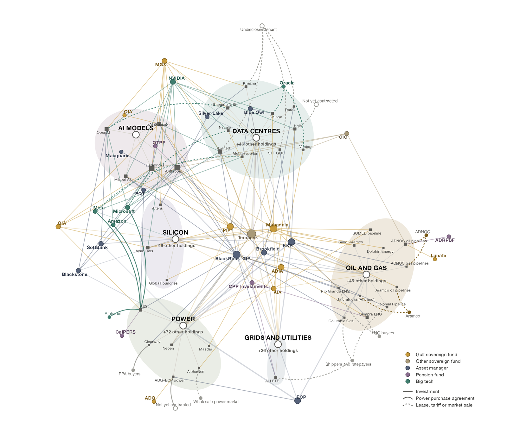

<a href="index.html" class="back-link">← Back to Projects</a>

:::: {.grid}

::: {.g-col-12 .g-col-lg-7}

Much like the 1930s and 1980s, geoeconomic conflict and great-power rivalry is synonymous with changing business models and new technologies. This project tries to unpack the green and digital transition as not just a conflict over regulating these technologies, but also about the underlying industrial organization. How amenable are electric cars and datacenters to globe-spanning, decentralized supply chains? The return of vertical integration in firms such as BYD, Amazon, and Meta would suggest that corporate organization itself changes with the technologies it builds its business around.

BYD produces an estimated 75 percent of its components in-house, designs its own silicon, and employs twice as many engineers as the Volkswagen group. Meanwhile, in the electronics supply chain, the rapid build-out of datacenters has led firms to enact a dense planning circuit where capacity and investment are synchronized and planned years into the future. In both cases, this dense corporate layer cake provides new levers for state power. Indeed, as these business models internationalize, they also raise questions over who controls the knowledge, equipment, and the capital needed to build a new generation of factories and what OpenAI now refers to as 'compute campuses'. 

:::

::: {.g-col-12 .g-col-lg-5}

::: {.related-work}
**Papers**

*Planning the Tech-Industrial Complex* (with L. Dagorne). Under review. Shows how long-term contracts establish priority claims on future capacity, and why Washington underwrites them.

*Vertical Integration in the Electric Vehicle Revolution* (with P. Gerbaudo and G. Anzolin). Manuscript available upon request. Compares BYD and Tesla with Toyota and Volkswagen.

*What Is Different About Chinese Automotive Capitalism?* (with P. Polyak). Paper in progress. Shows how integration, demand pressures, and geopolitical steering combine to carry industrial stacks abroad.
:::

:::

::::
