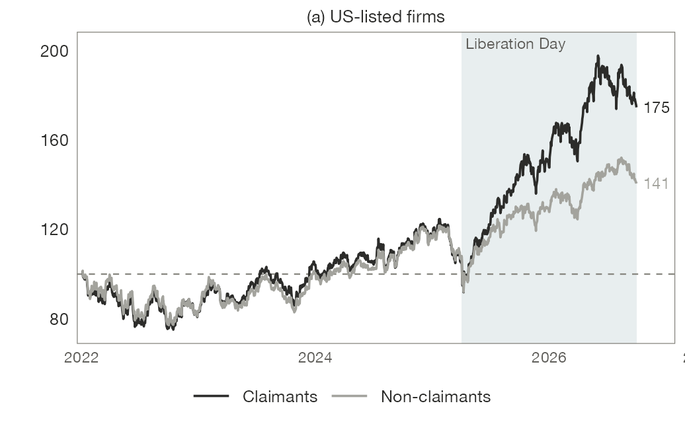

<a href="index.html" class="back-link">← Back to Projects</a>

:::: {.grid}

::: {.g-col-12 .g-col-lg-7}

Under globalization, firms built globe-spanning supply chains calibrated to deliver low lead times, efficiency, optimized to the last cent. That model presupposed geopolitical calm and legal certainty over property rights. Since the late 2010s, resurgent national industrial policy, tariffs, export controls, and war have thrown that model in disarray.

We are only beginning to understand how firms adapt their strategies, how this varies within and between sector, and how markets themselves are redrawn around new priorities. Moreover, a formidable challenge lies in how to measure changing corporate strategies: the firm as an organizing bureaucracy must be [separated](https://www.annualreviews.org/content/journals/10.1146/annurev-lawsocsci-042224-103615) from the legal architecture - if not outright fiction - of the corporation.

This project's aim is to provide a firm-level perspective on how geoeconomics are institutionalized in corporate strategy: from the way executives narrate their choices and analyses of the world to analysts in earnings calls, to what firms disclose in annual reports, and what they ultimately do to their ownership and supply chain structure.

:::

::: {.g-col-12 .g-col-lg-5}

::: {.related-work}
**Papers**

*The Geopolitical Construction of Markets.* Manuscript available upon request. Traces how claims of necessity become durable participation in state projects.

*[Hierarchies of Adaptation](https://osf.io/preprints/socarxiv/gwuce_v1).* OSF Preprint, 2026. An earlier version of the argument.
:::

:::

::::
