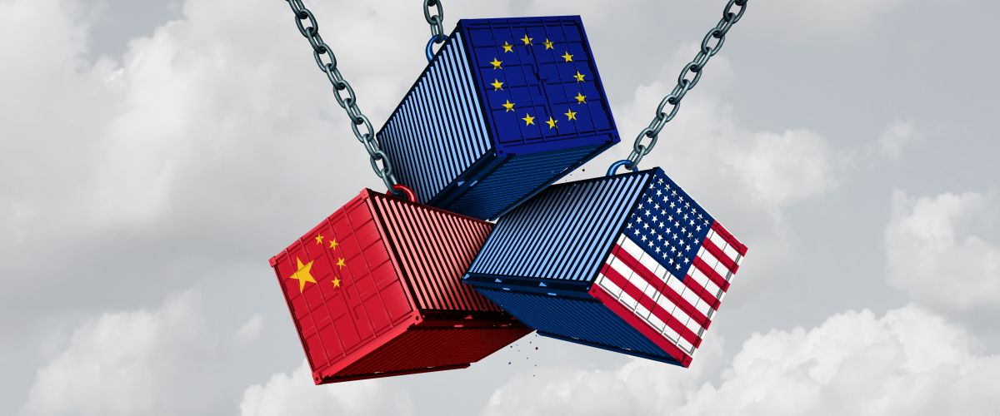

<a href="index.html" class="back-link">← Back to Projects</a>

:::: {.grid}

::: {.g-col-12 .g-col-lg-7}

Why is industrial policy *en vogue* in the European Union? The fear of falling behind has long driven European integration, but the answer used to be more market creation. Given the EU's market-making impetus, its tilt toward fiscal austerity, and its limits on state aid, the recent turn to directing economic activity is surprising. I have traced how the geopoliticization of trade gave neo-mercantilist and socially oriented actors an opening to challenge Europe's embedded neoliberal compromise, and how the Commission took on a far more active role in the name of technological sovereignty.

How this works on the ground is another matter. The conditions attached to the EU's flagship subsidies, the Important Projects of Common European Interest, bring perverse outcomes, adverse selection, and workarounds: one chipmaker had to throw away a perfectly good test batch, because selling it would have counted as mass production. Outcomes are decided where firms meet instruments, so my current work turns to the firms themselves. In 2022, Annalena Baerbock warned business elites that they “cannot afford to act following a ‘business first’ mantra alone.” Which firms back European sovereignty in what they do as well as in what they say? Are they patriots, or profiteurs?

:::

::: {.g-col-12 .g-col-lg-5}

::: {.related-work}
**Papers**

*Patriots or Profiteurs?* (with R. Bosticco). Paper in progress. Explains how firms respond, economically and politically, to sovereignty-seeking policy in semiconductors and batteries.

*[The Costs of Conditionality](https://journals.sagepub.com/doi/10.1177/10245294251320675)* (with T. Seidl and T. Wuttke). *Competition & Change*, 2026. Examines how the EU's flagship industrial policy works on the ground.

*[Picking Losers](https://onlinelibrary.wiley.com/doi/10.1111/rego.70004)* (with T. Ergen). *Regulation & Governance*, 2025. Documents how decarbonization drew the EU into managing decline in targeted regions and sectors.

*[Moving On to Not Fall Behind?](https://www.tandfonline.com/doi/full/10.1080/13501763.2023.2248204)* (with T. Seidl). *Journal of European Public Policy*, 2024. Reconstructs the “geo-dirigiste” turn through Europe's fear of falling behind. JEPP Best Paper Prize 2024.

*[Europe First?](https://doi.org/10.1080/13501763.2023.2202684)* (with D. Di Carlo). *Journal of European Public Policy*, 2023. Charts the rise of an EU industrial policy that promotes and protects the single market.

*[As Open as Possible, as Autonomous as Necessary](https://doi.org/10.1111/jcms.13428)* (with T. Seidl). *Journal of Common Market Studies*, 2023. Shows how the Commission used open strategic autonomy as a coalition magnet.

*When External Pressures Shift Domestic Coalitions* (with J. Simons). Manuscript available upon request. Traces the Dutch shift from horizontal orthodoxy through covert verticalism to overt interventionism.

*Whose Strategic Autonomy?* (with D. Karas). Manuscript available upon request. Asks whether integration leaves Ukraine a raw-material supplier or moves it up the value chain.
:::

:::

::::
