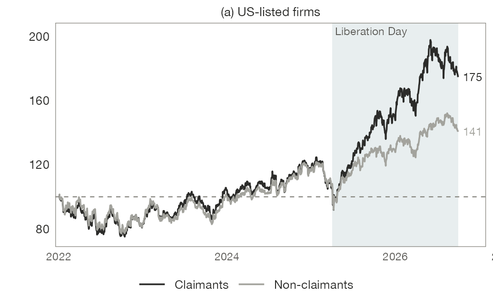
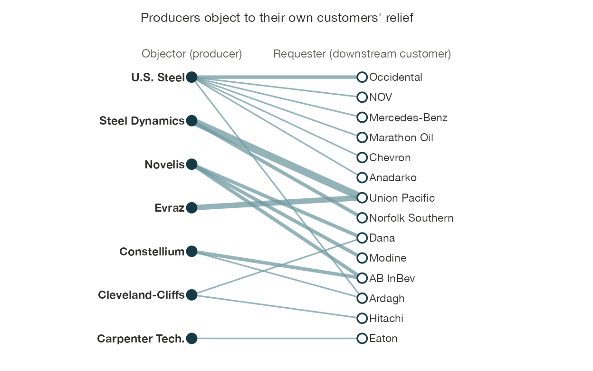
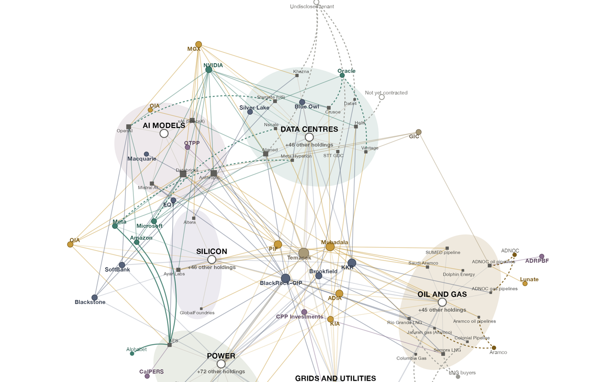
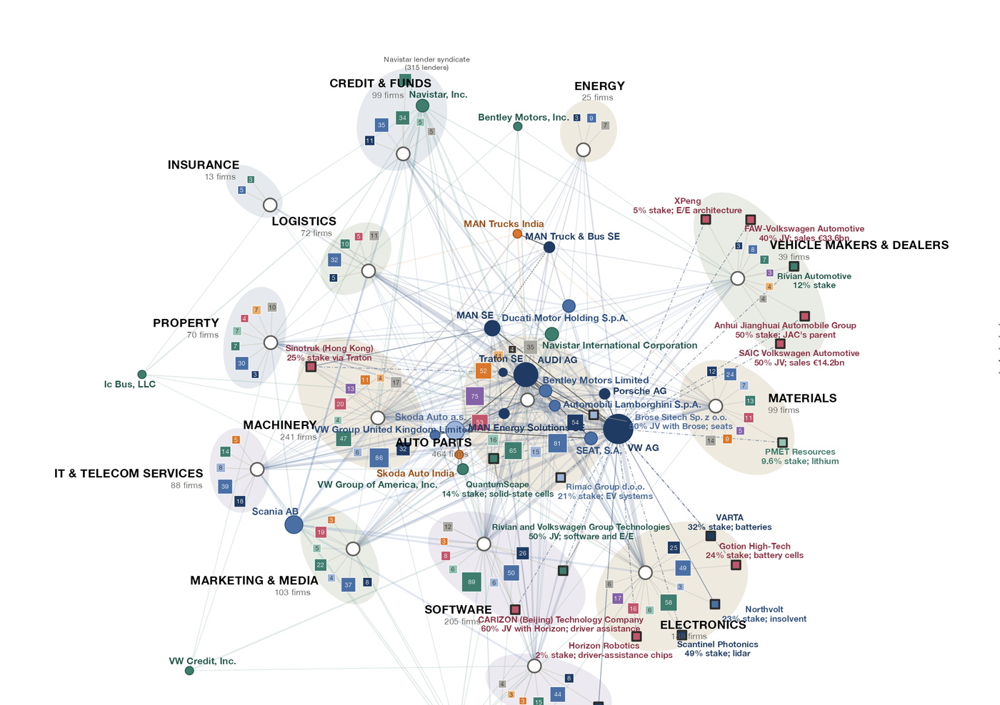

::: {.projects-grid}

::: {.project-card}
<a href="economic-security.html" class="project-link">

Markets and Security
<h3>Changing the Calculus on Economic Security</h3>

How do firms operate in a world of competing state projects? And how are markets reconstructed to value beyond efficiency?

Read More →

</a>
:::

::: {.project-card}
<a href="politics-of-fracture.html" class="project-link">

How Geoeconomics Becomes Domestic Politics
<h3>The Politics of Fracture</h3>

If geoeconomics turns value chains from a coalitional device to a site of contestation, how will it change state-business relations?

Read More →

</a>
:::

::: {.project-card}
<a href="corporate-planning.html" class="project-link">

After the Modular Firm
<h3>Corporate Planning and Grand Strategy</h3>

From battery cells to data centers, firms are replacing the market with planning and integration. How does this affect public authority over who controls these technologies?

Read More →

</a>
:::

::: {.project-card}
<a href="geoeconomic-predicament.html" class="project-link">

European Political Economy
<h3>Europe's Geoeconomic Predicament</h3>

How does Europe's turn to market-direction play out on the ground?

Read More →

</a>
:::

::: {.project-card}
<a href="mesonomics.html" class="project-link">

Methods and Data
<h3>Mesonomics: Rescaling Political Economy</h3>

Geoeconomics is also a problem of resolution: difficult to find in the aggregates, but unmistakable in meso and micro-level data.

Read More →

</a>
:::

::: {.project-card}
<a href="bookproject.html" class="project-link">

Book project
<h3>Stacking Order</h3>

Who governs the post-neoliberal industrial order?

Read More →

</a>
:::

:::
