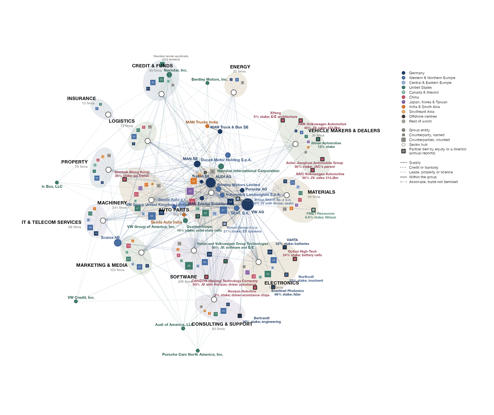

<a href="index.html" class="back-link">← Back to Projects</a>

:::: {.grid}

::: {.g-col-12 .g-col-lg-7}

Go looking for the great decoupling in the trade aggregates and it tends to disappear in oceans of data, as flows reroute through Vietnam and Mexico rather than collapse. Go looking inside a single firm and everything seems to have changed. Political economists have long bet on one resolution or the other, which Thomas Oatley called the [reductionist gamble](https://www.cambridge.org/core/journals/international-organization/article/reductionist-gamble-open-economy-politics-in-the-global-economy/AEBC7A2C1F164ACC8517ADEF13FDFAAF). Yet the action now sits in between, in the supply chains, ownership networks, and investment circuits through which states and firms reach one another.

[Mesonomics](https://www.project-syndicate.org/onpoint/mesoeconomics-study-of-networks-supply-chains-key-to-successful-industrial-policies-by-william-h-janeway-2024-05) is my effort to build instruments for that middle layer. The core is a thermometer for corporate activity: 46,348 earnings calls held by 9,450 firms since 2016, read with language models validated against hand coding, and linked to some 766,000 buyer-seller ties, share prices, lobbying records, and tariff petitions. This lets me set what firms claim against what they hold, what investors pay for, and what states give.

:::

::: {.g-col-12 .g-col-lg-5}

::: {.related-work}
**Resources**

*[A Primer for the Use of Classifier and Generative Large Language Models in Social Science Research](https://osf.io/preprints/osf/r3qng_v1)* (with J. Cova). OSF Preprint, 2024. A practical guide, with [replication materials](https://github.com/joshcova/LLMs-for-social-scientists/tree/main).

The earnings-call and supply-chain database underpins [Changing the Calculus on Economic Security](economic-security.html) and [The Politics of Fracture](politics-of-fracture.html).
:::

:::

::::
