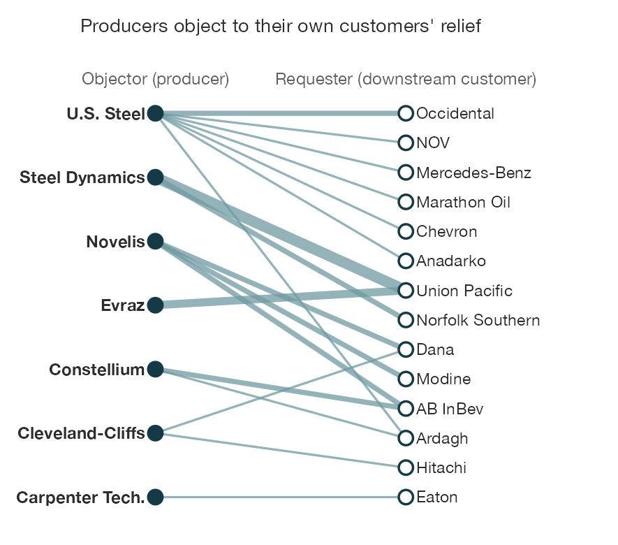

<a href="index.html" class="back-link">← Back to Projects</a>

:::: {.grid}

::: {.g-col-12 .g-col-lg-7}

In 2018, the electrical-equipment maker Eaton filed more than sixty requests to exempt its imports from American steel tariffs, each for itself alone. Three years later, it lobbied for clean-energy credits through a lobbying firm it shared with a power producer, an offshore-wind developer, and a biofuels company. Our theories of trade politics do not predict this switch, because they were built for liberalization, when value chains were the scaffolding of coalitions.

This project traces what becomes of business politics when geoeconomics arrives as restriction, as reward, or as shock. Restrictions offer relief that each firm claims for itself, so steelmakers end up objecting to the exemptions of their own customers. Inducements create programs that must be won and defended together. Shocks without an instrument behind them mobilize no one, because politics needs an address. Distributive conflict thus cuts through sectors rather than between them. Whose interest, then, is "the European car industry's"?

:::

::: {.g-col-12 .g-col-lg-5}

::: {.related-work}
**Papers**

*Exit, Coalitions, and Anomy: Business Politics under Geoeconomics.* Paper in progress. Links exposure in earnings calls to federal lobbying disclosures, tariff-relief petitions, and firm-to-firm supply-chain networks.
:::

:::

::::
