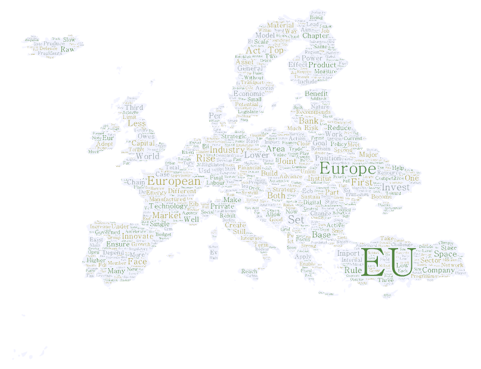

<a href="index.html" class="back-link">← Back to Courses</a>

:::: {.grid}

::: {.g-col-12 .g-col-lg-7}

## Course description

From the size of cucumbers and tractor seats to fights between member states over fiscal rules and the European Commission’s attempts at taking on big tech firms for antitrust and privacy infringements, the European Union has a large footprint in our everyday life. Due to the EU’s technocratic nature and ‘home’-bias of national news reporting, this footprint often turns invisible. Behind the web of institutions and jargon rests a fascinating political story about shaping and governing global markets. Welcome to the field of European Political Economy!

The goal of this course is to help you clear the hump that makes it hard to appreciate these qualities about the political economy of the European Union. There are clear upfront costs in understanding how fields such as monetary policy, trade policy, or cohesion policy work. These upfront costs are worth it because so much of what happens in the member states and our everyday life is decided by rules and laws that are negotiated in Brussels. This is neither a question of politics nor economics, given that markets are politically constructed. Hence, we need a political economy perspective to truly appreciate these important qualities of the European Union.

The course is structured in two parts spanning a total of ten substantive lectures. The first half establishes various theory-oriented foundations, from the creation of the European single market to the E(M)U’s near-collapse during the Eurozone crisis, and subsequent reforms. We will use these insights to deepen the discussion of the five current issues in European Political Economy. These are both ongoing issues and hotly debated subjects among academics.

:::

::: {.g-col-12 .g-col-lg-5}

::: {.related-work}
**Syllabus**

You can download the syllabus [here](EPE_Manual_2425.pdf).
:::

:::

::::
