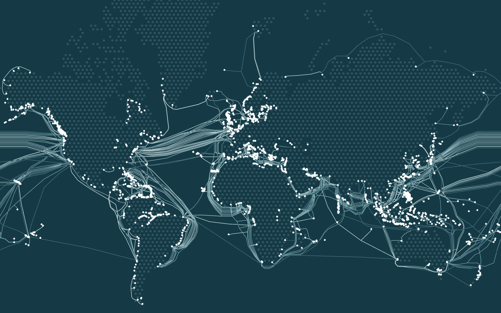

<a href="index.html" class="back-link">← Back to Courses</a>

:::: {.grid}

::: {.g-col-12 .g-col-lg-7}

## Course description

This course offers students an introduction to the subject of International Political Economy (IPE). Throughout, the course will be guided by the question to which extent, and how, the current process of globalization is changing the relationship between states and markets, between public regulation and the private economy, between state and capital. Traditionally IPE studies the relationship between ‘the economic’ and ‘political’ within the interaction of – patterns of cooperation and conflict between – national states. If anything, the global financial and economic crisis of 2008 has made clear that this state-centric perspective is no longer adequate. With processes of globalization and transnationalization national economies have become so much integrated, and their governance at various levels so much enmeshed, that what is properly called the global political economy is about much more than just states and their interests but also about private actors such as transnational corporations, NGOs and all their different relations across and transcending national borders. At the same time, the crisis has shown that states, although apparently vulnerable in the face of global market forces, are also crucial when it comes to protecting the workings of global capitalism. This shows that the relationship between states and markets is not a one-way street. In other words, politics and policies are shaped by economic globalization but the latter is also driven by politics, and shaped (indeed enabled) by the policy choices that states make. It is from this perspective that this course will examine the various theoretical approaches within IPE, and then analyse how the contemporary global political economy has evolved historically. We will then proceed by analysing the current globalization of trade, production, and finance, as well as their global governance through transnational regimes and the role of International Organizations such as the IMF and the WTO within those regimes. The financial crisis, the political economy of underdevelopment, the power shift to the East and the relationship between the political economy of energy and of the environment will round off our overview of the contemporary global political economy.

:::

::: {.g-col-12 .g-col-lg-5}

Submarine cables and landing sites, adapted from TeleGeography's <a href="https://www.submarinecablemap.com/">Submarine Cable Map</a>, <a href="https://creativecommons.org/licenses/by-sa/4.0/">CC BY-SA 4.0</a>. Land: Natural Earth.

:::

::::
