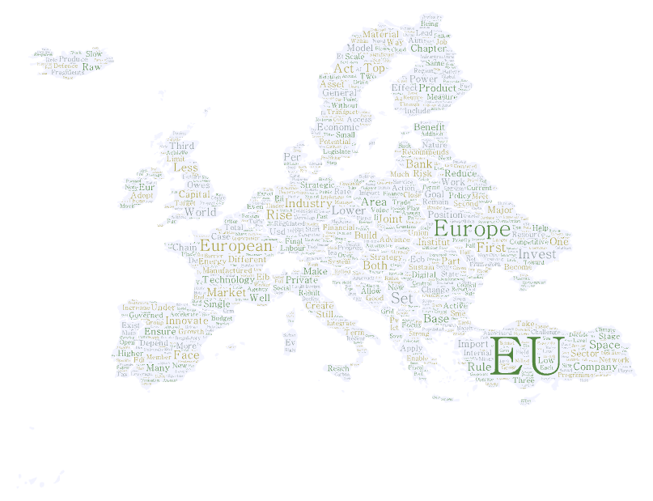
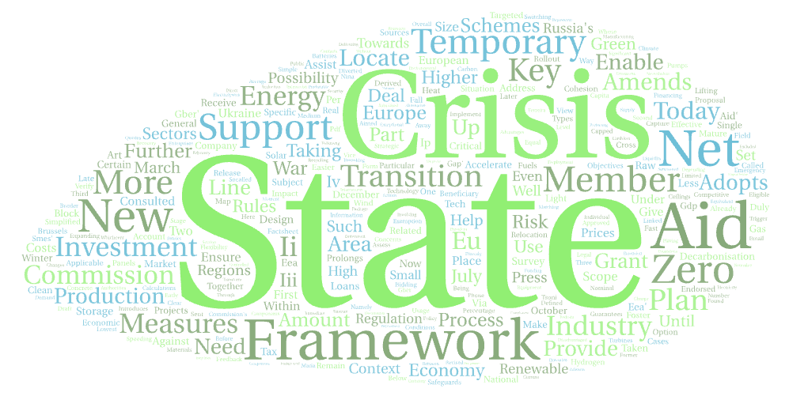

I teach courses on the political economy of European integration, the IPE of multinational corporations, and natural language processing.

::: {.projects-grid}

::: {.project-card}
<a href="epe.html" class="project-link">

University of Cologne
<h3>European Political Economy</h3>

2024–25, Undergraduate

Read More →

</a>
:::

::: {.project-card}
<a href="gpe.html" class="project-link">

Vrije Universiteit Amsterdam
<h3>Global Political Economy</h3>

2026–27, Undergraduate

Read More →

</a>
:::

::: {.project-card}
<a href="sigpe.html" class="project-link">

Vrije Universiteit Amsterdam
<h3>Selected Issues: Global Political Economy and Geopolitics</h3>

2026–27, Graduate

Read More →

</a>
:::

::: {.project-card}
<a href="nlp.html" class="project-link">

Max Planck Institute for the Study of Societies
<h3>Natural Language Processing for Social Scientists</h3>

2025–26, Graduate/Postgraduate

Read More →

</a>
:::

:::
