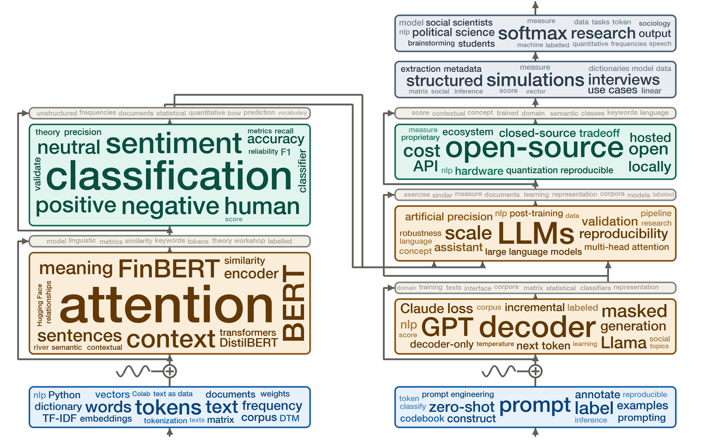

<a href="index.html" class="back-link">← Back to Courses</a>

:::: {.grid}

::: {.g-col-12 .g-col-lg-7}

## Course description

This course, taught with Joshua Cova, is intended to provide an intuition to graduate and postgraduate researchers in political science and sociology on how they can work with text as data, from introductory quantitative text analysis to machine learning text classifiers and large language models (LLMs). Throughout, we combine theory (validity, reliability, research design) with methods and practice in Python. The first part lays out the conceptual foundations behind natural language processing and why theory matters before code. It then turns to the building blocks of NLP and their implementation in Python: frequency analysis, sentiment analysis, bag-of-words models, and binary text classification.

The second part covers the innovations that have powered the current boom in LLMs and works through what that means for social scientists. We move from word embeddings to the transformers architecture and BERT models, and focus on how to systematically use machine learning text classifiers and LLMs to annotate and classify texts. We also discuss how researchers should interact with LLMs in a scientific setting, open versus closed-source alternatives, other use cases such as experiments, simulations, interviews, and metadata extraction, and quantized, locally hosted models. While the instructors provide a text corpus to work with, students are also encouraged to use their own data. At the end, students and instructors work together in a collaborative brainstorming session to explore how the concepts and tools covered in the course can be applied to their own research questions.

:::

::: {.g-col-12 .g-col-lg-5}

:::

::::
